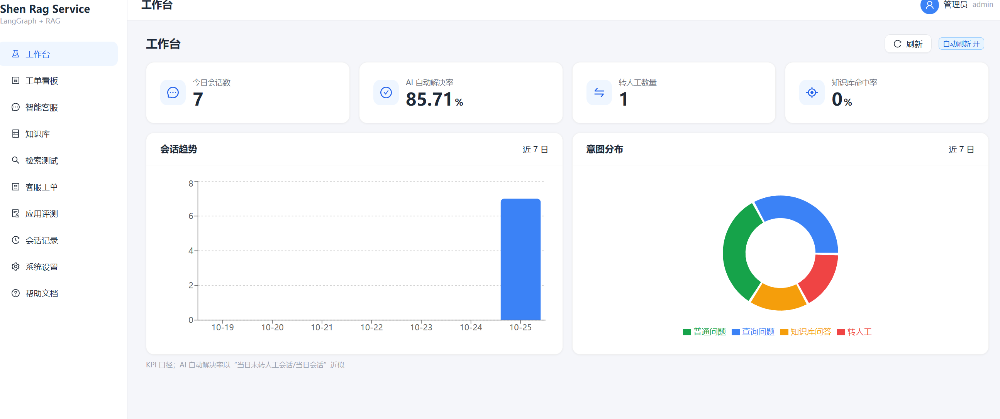
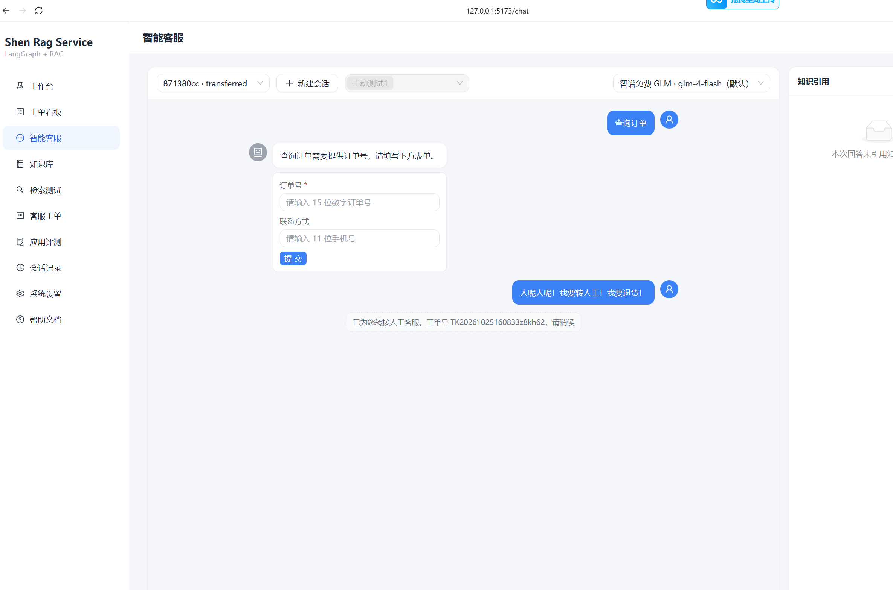
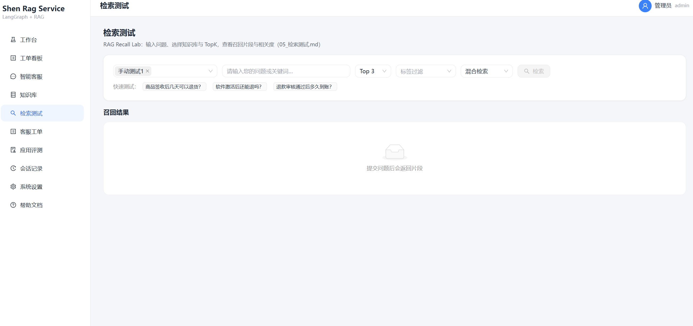
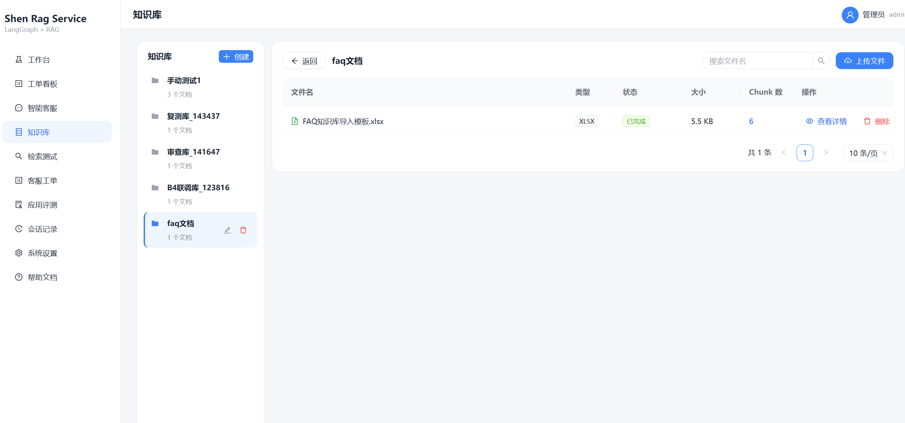
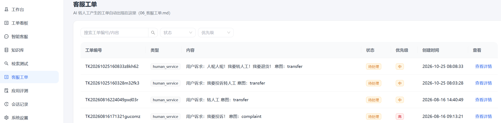
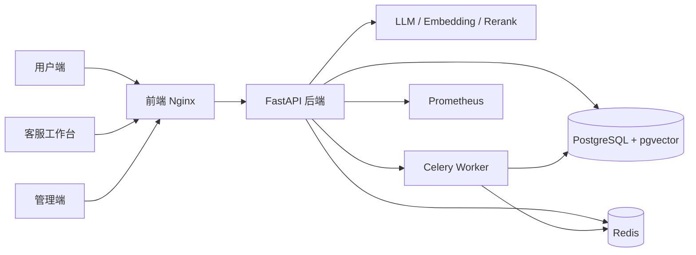

# Shen Rag Service

面向企业的一站式 AI 智能客服平台，覆盖「知识库管理 → 检索验证 → 智能应答 → 应用评测 → 工单流转 → 数据看板」完整运营闭环。系统同时提供**管理端**、**客服工作台**与**用户自助端**，并内置权限隔离、审计日志与实时联动能力。

> 技术核心：**FastAPI + LangGraph + RAG**（pgvector + 混合检索 + 重排），前端为 **React 18 + Ant Design 5**。

[](https://github.com/whs2007/shen-rag-service/actions/workflows/ci.yml)


## 功能特性

### 知识管理

- 知识库 CRUD、软删除、按角色/用户控制可见性
- 多格式文档导入：`xlsx` / `csv` / `md` / `txt` / `pdf` / `docx`
- 文档解析、分块、向量化，支持解析失败重试与 Chunk 在线编辑
- 内置 FAQ 导入模板，降低冷启动成本

### 检索验证

- pgvector 向量检索 + tsvector 全文检索 + RRF 融合
- SiliconFlow 重排（无 Key 时自动降级为混合检索）
- 多知识库、标签过滤、TopK 与检索模式可配
- 可视化「RAG Recall Lab」，对比召回与重排前后结果

### 智能应答

- LangGraph 对话图：意图路由、RAG 问答、转人工、兜底升级
- SSE 流式输出，附带引用片段、反馈与对话内表单卡片
- 会话持久化、历史恢复、模型运行时切换
- 支持智谱 GLM 起步，兼容 OpenAI / DeepSeek / SiliconFlow / Ollama

### 应用评测

- 评测集 / 评测任务 / 评测报告，支持批量导入与 30 条公开样例
- LLM-as-judge 打分 + 人工调通过 + 低质量样本回流闭环

### 工单与运营

- 工单三栏工作台、原子认领、回复/关闭与完整时间线
- 数据看板：会话趋势、意图分布、工单 KPI
- 会话记录检索、人工标注与评测回流
- 用户端自助注册 / 登录、在线咨询、我的工单与个人中心

### 系统与安全

- 系统设置六 Tab：模型 / Prompt / 客服规则 / 账号权限 / 日志审计 / 数据管理
- JWT + RBAC、登录锁定、注册限流、内容审核
- API Key Fernet 加密存储、上传文件嗅探校验
- Prometheus 指标、Celery 异步任务与日志告警

## 界面预览

| 工作台 | 智能客服 | 检索测试 |
| --- | --- | --- |
|  |  |  |

| 知识库 | 客服工单 |
| --- | --- |
|  |  |

## 技术栈

| 层次 | 技术选型 |
| --- | --- |
| 后端 | Python 3.11+ / FastAPI / SQLAlchemy 2.0（async）/ Alembic / PostgreSQL 15+（pgvector）/ Redis / Celery / structlog |
| 前端 | Vite / React 18 / TypeScript / Ant Design 5 / Zustand / TanStack Query |
| AI | 智谱 GLM（LLM）、bge-m3（Embedding，1024 维）、SiliconFlow bge-reranker-v2-m3（重排） |
| 部署 | Docker Compose / Nginx / Prometheus / Grafana / Celery Beat |

## 系统架构



## 目录结构

```text
.
├── backend/                 # FastAPI 后端、Alembic 迁移、测试与部署配置
│   ├── app/                 # 应用代码（api / agents / rag / services / models）
│   ├── alembic/             # 数据库迁移
│   ├── samples/             # FAQ 知识库导入模板
│   ├── scripts/             # 性能抽测、样例生成等工具脚本
│   ├── tests/               # pytest 测试
│   ├── docker-compose.yml   # 全栈部署编排
│   └── pyproject.toml
├── frontend/                # React 管理端 / 用户端 / 客服工作台
│   ├── src/
│   ├── Dockerfile
│   ├── nginx.conf
│   └── package.json
├── docs/
│   └── screenshots/         # 界面截图（README 引用）
├── .github/workflows/       # CI（后端 pytest/ruff/mypy，前端 lint/build/test）
├── .env.example             # 环境变量模板（复制后填写真实值）
└── README.md
```

## 快速开始

### 方式一：Docker Compose（推荐）

前置条件：已安装 Docker 与 Docker Compose。

```bash
cd backend
cp .env.example .env
# 编辑 .env，至少设置：POSTGRES_PASSWORD / REDIS_PASSWORD / JWT_SECRET / GRAFANA_ADMIN_PASSWORD
# 首次部署建议同时设置 ADMIN_INITIAL_PASSWORD，迁移服务会自动创建初始管理员
docker compose up -d --build
```

服务启动后：

- 前端：<http://localhost:8080>
- API 健康检查：<http://127.0.0.1:8001/health>（仅本机直连调试，公网流量走 Nginx）
- Prometheus：<http://127.0.0.1:9090>
- Grafana：<http://127.0.0.1:3000>

### 方式二：本地开发

#### 后端

```bash
cd backend
python -m venv .venv
.venv\Scripts\activate            # Windows；macOS/Linux 使用 source .venv/bin/activate
pip install -e ".[dev]"
cp .env.example .env              # 按需填写 DATABASE_URL / JWT_SECRET 等
alembic upgrade head
python -m app.cli bootstrap       # 首次部署引导初始管理员
uvicorn app.main:app --reload --port 8000
```

#### 前端

```bash
cd frontend
npm install
npm run dev                       # http://localhost:5173，/api 代理到 127.0.0.1:8000
```

## 配置说明

完整环境变量模板见 [`backend/.env.example`](backend/.env.example)。常用配置：

| 变量 | 说明 |
| --- | --- |
| `DATABASE_URL` | PostgreSQL 连接串（需 pgvector） |
| `REDIS_URL` | Redis 连接串（Celery / 会话缓存 / 实时事件中继） |
| `JWT_SECRET` | JWT 签名密钥，**生产必须替换为强随机值** |
| `LLM_API_KEY` / `LLM_MODEL` | 对话模型配置（默认智谱 GLM） |
| `EMBEDDING_API_KEY` / `EMBEDDING_MODEL` | Embedding 配置（默认 bge-m3） |
| `RERANK_API_KEY` / `RERANK_BASE_URL` | 重排配置（默认 SiliconFlow） |
| `ADMIN_INITIAL_PASSWORD` | 首次部署的初始管理员密码 |
| `METRICS_TOKEN` | Prometheus 抓取 `/metrics` 的专用 Token |

> 开发环境未设置 `ADMIN_INITIAL_PASSWORD` 时会创建 `admin/admin123` 并输出告警（仅限本地）；`ENVIRONMENT=production` 会拒绝默认 `JWT_SECRET`，启动即报错。

## 测试

后端：

```bash
cd backend
pytest -q
ruff check app tests
mypy app
```

前端：

```bash
cd frontend
npm run lint
npm run test
npm run build
```

CI 工作流会在 push / PR 时自动执行上述检查。

## API 概览

| 模块 | 入口 |
| --- | --- |
| 认证与用户 | `/api/auth/*`、`/api/user/*` |
| 知识库与文档 | `/api/knowledge-bases/*`、`/api/documents/*`、`/api/chunks/*` |
| 检索验证 | `/api/retrieval/*` |
| 智能对话 | `/api/chat`、`/api/sessions/*` |
| 应用评测 | `/api/evaluations/*` |
| 工单与工作台 | `/api/tickets/*`、`/api/dashboard/*` |
| 系统设置与审计 | `/api/settings/*`、`/api/admin/*`、`/api/audit-logs` |
| 可观测 | `/health`、`/metrics` |

本地启动后可通过 <http://127.0.0.1:8000/docs> 查看交互式 API 文档。

## 安全与脱敏约定

- 所有密钥（`LLM_API_KEY`、`EMBEDDING_API_KEY`、`RERANK_API_KEY`、`JWT_SECRET`、数据库口令等）只保存在已被 `.gitignore` 忽略的 `.env` 中，**严禁写入代码、文档、日志或提交到仓库**。
- 仓库内仅保留 `.env.example` 模板，值为空或占位符；若曾泄露过真实 Key，请立即到对应服务商控制台重置。
- 数据库中的 API Key 使用 Fernet 加密（密钥派生自 `JWT_SECRET`），接口返回脱敏值。
- 日志对密码、Token、手机号等敏感字段进行脱敏。
- 知识库内容按知识库、角色与用户进行行级权限隔离。

## 贡献指南

欢迎提交 Issue 与 Pull Request。提交前请：

1. 运行本地测试与 lint，确保通过。
2. 不要提交 `.env`、真实密钥、个人笔记或过程文档。
3. 遵循现有代码风格与提交信息约定。

## License

当前仓库尚未包含 `LICENSE` 文件。若计划开源，建议根据实际情况选择 **MIT** 或 **Apache-2.0** 并补充许可证。
